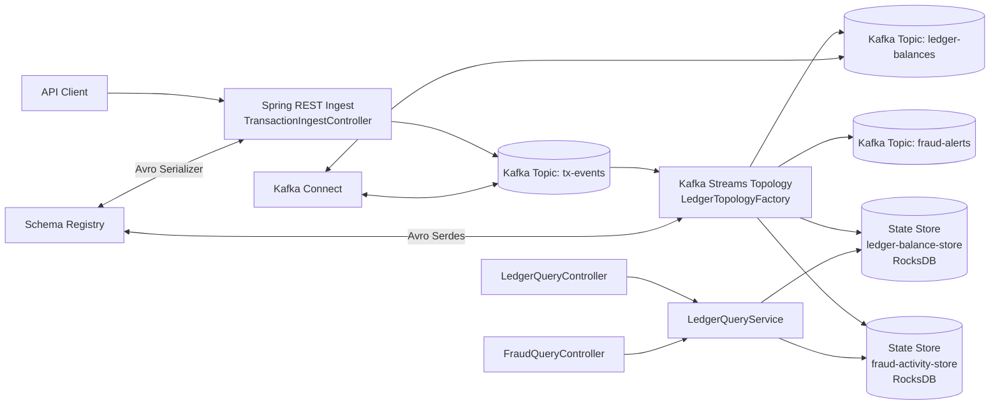
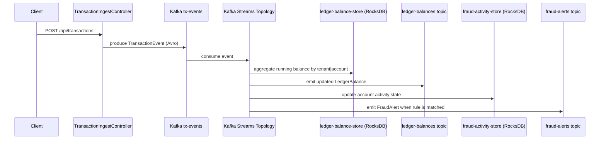
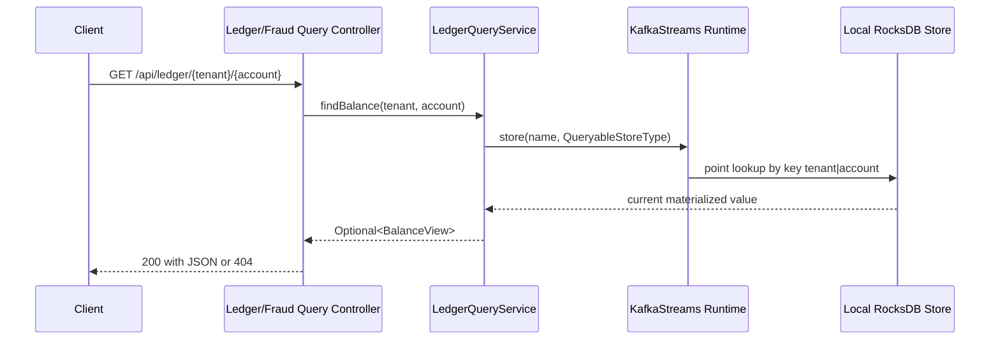
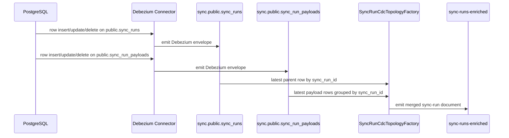

# Application Architecture and Kafka Streams Theory

This document is the deep technical reference for this repository.

It explains:
- every major application module and responsibility
- internal communication paths from API to topics to state stores
- integrations with Kafka, Schema Registry, Kafka Connect, and monitoring
- Kafka and Kafka Streams theory tied directly to this codebase

If you are onboarding for a senior Kafka role, this is the document to read after `README.md` and before running advanced labs from `docs/testing-playbook.md`.

## 1. System Goal and Domain Model

This project implements a small finance-oriented event platform with two core capabilities:

- ledgering: maintain running account balances from transaction events
- fraud signal generation: detect suspicious events based on amount and burst activity

It is intentionally designed around stateful stream processing so you can practice:

- source-of-truth streaming models
- interactive queries on local state stores
- exactly-once stream processing mode
- schema-governed event contracts
- multi-tenant key modeling

## 2. High-Level Architecture



## 3. Runtime Components and Responsibilities

### 3.1 Spring Boot application

- Entry point: `src/main/java/com/example/ledger/LedgerLearningApplication.java`
- Hosts REST APIs and Kafka Streams runtime in one process.

### 3.2 API layer (`src/main/java/com/example/ledger/api`)

- `TransactionIngestController`
  - accepts `POST /api/transactions`
  - maps HTTP payload to Avro `TransactionEvent`
  - publishes to `tx-events`
- `LedgerQueryController`
  - serves `GET /api/ledger/{tenantId}/{accountId}`
  - returns current materialized balance from state store
- `FraudQueryController`
  - serves `GET /api/fraud/{tenantId}/{accountId}`
  - returns current fraud activity state snapshot

### 3.3 Stream processing layer (`src/main/java/com/example/ledger/streams`)

- `LedgerTopologyFactory`
  - builds the topology (DSL + Processor API)
  - performs balance aggregation into a KTable-backed state store
  - invokes fraud transformer and emits alerts
- `SyncRunCdcTopologyFactory`
  - consumes Debezium CDC topics for `public.sync_runs` and `public.sync_run_payloads`
  - re-keys child payload events by `sync_run_id`
  - materializes latest parent row and current payload collection
  - emits merged JSON documents to `sync-runs-enriched`
- `FraudDetectorTransformer`
  - custom stateful Processor API transformer
  - tracks per-account event burst window
  - emits `FraudAlert` when threshold rules are met
- `LedgerQueryService`
  - accesses `KafkaStreams` interactive query API
  - reads local `ReadOnlyKeyValueStore` instances by store name
- `Topics`
  - central names for topics and stores

### 3.4 Configuration layer (`src/main/java/com/example/ledger/config`)

- `KafkaStreamsConfig`
  - enables Kafka Streams with `@EnableKafkaStreams`
  - configures Avro serdes for `TransactionEvent`, `LedgerBalance`, `FraudAlert`
  - wires both the ledger/fraud topology and the Debezium CDC merge topology
- `TopicConfig`
  - creates topics at startup via Spring Kafka Admin
  - marks `ledger-balances` and `sync-runs-enriched` as compacted
- `LedgerStreamProperties`
  - binds fraud thresholds from `application.yml`

### 3.5 Infrastructure integrations

- Kafka broker and ZooKeeper: `docker-compose.yml`
- Schema Registry: `docker-compose.yml`
- Kafka Connect: `docker-compose.yml` and `connect/*.json`
- Kafka UI: `docker-compose.yml`

## 4. Internal Communication Paths

### 4.1 Write path: HTTP -> Kafka -> Streams -> state/topics



### 4.2 Read path: HTTP -> Interactive Query -> local state store



### 4.3 Key model and tenant isolation

This system uses a canonical composite key format:

- key: `tenantId|accountId`

Why it matters:

- ensures tenant scoping in all state stores
- preserves co-location in partitioned processing
- keeps query contract deterministic between topology and API

### 4.4 CDC merge path: Postgres -> Debezium -> Kafka Streams -> merged topic



This path demonstrates a common financial-integration pattern:

- CDC captures operational database changes without polling.
- Kafka Streams turns table-shaped change events into a consumer-friendly domain view.
- downstream services read one merged topic instead of implementing their own joins.

## 5. Data Contracts and Topic Catalog

### 5.1 Avro contracts

Source of contracts:
- `src/main/avro/TransactionEvent.avsc`
- `src/main/avro/LedgerBalance.avsc`
- `src/main/avro/FraudAlert.avsc`

#### TransactionEvent

| Field | Type | Description |
|---|---|---|
| eventId | string | Event identity from producer/API |
| tenantId | string | Tenant scope |
| accountId | string | Account scope within tenant |
| amount | double | Absolute amount from request |
| direction | enum(DEBIT,CREDIT) | Sign behavior in aggregation |
| currency | string | Currency code, defaults to USD |
| eventTime | long | Epoch millis event timestamp |

#### LedgerBalance

| Field | Type | Description |
|---|---|---|
| tenantId | string | Tenant of the account |
| accountId | string | Account identifier |
| balance | double | Running signed balance |
| currency | string | Last observed currency |
| lastEventTime | long | Last processed event timestamp |

#### FraudAlert

| Field | Type | Description |
|---|---|---|
| tenantId | string | Tenant scope |
| accountId | string | Account scope |
| eventId | string | Triggering event id |
| reason | string | Rule reason code |
| amount | double | Triggering event amount |
| eventTime | long | Triggering event timestamp |

### 5.2 Topics and stores

| Name | Kind | Partitions | Compacted | Produced by | Consumed by |
|---|---|---:|---|---|---|
| `tx-events` | Topic | 6 | No | `TransactionIngestController` | Streams topology |
| `ledger-balances` | Topic | 6 | Yes | Streams aggregation | Downstream consumers / Connect |
| `fraud-alerts` | Topic | 6 | No | Fraud transformer path | Downstream consumers |
| `ledger-balance-store` | State store | N/A | N/A | Streams aggregation | Interactive query API |
| `fraud-activity-store` | State store | N/A | N/A | Fraud transformer | Interactive query API |

Note: changelog topics for state stores are created automatically by Kafka Streams.

## 6. Topology Walkthrough (Code-Level)

Reference file: `src/main/java/com/example/ledger/streams/LedgerTopologyFactory.java`

### Step A: consume input stream

- Reads `tx-events` as `KStream<String, TransactionEvent>`.
- Uses `Consumed.with(StringSerde, TransactionEventSerde)`.

### Step B: re-key for tenant/account partitioning

- `selectKey((k, v) -> v.getTenantId() + "|" + v.getAccountId())`
- This key is reused everywhere else.

### Step C: aggregate balances into KTable

- Groups by key and aggregates into `LedgerBalance`.
- Signed amount logic:
  - `DEBIT` -> subtract absolute amount
  - `CREDIT` -> add absolute amount
- Materializes to store name `ledger-balance-store`.

Formula used:

```text
newBalance = oldBalance + signedAmount
signedAmount = +abs(amount) for CREDIT
signedAmount = -abs(amount) for DEBIT
```

### Step D: publish materialized updates

- `balances.toStream().to("ledger-balances")`
- This emits a new balance record for each aggregate update.

### Step E: execute fraud transformer

- Invokes `transform(() -> new FraudDetectorTransformer(properties), ..., "fraud-activity-store")`
- Updates activity store and emits alert only when a rule matches.
- Null results are filtered out before writing to `fraud-alerts`.

## 7. Fraud Logic Internals

Reference file: `src/main/java/com/example/ledger/streams/FraudDetectorTransformer.java`

Rules currently implemented:

1. single transaction threshold:
   - alert when `abs(amount) >= singleTransactionAlertThreshold`
2. burst activity threshold:
   - track event count in window per account
   - reset window when `eventTime - windowStartMs > burstWindowMs`
   - alert when `eventsInWindow >= burstCountThreshold`

Alert reason mapping:

- `SINGLE_TX_THRESHOLD_EXCEEDED`
- `BURST_ACTIVITY_DETECTED`

State object used:

- `AccountActivity` with fields `eventsInWindow`, `windowStartMs`, `lastEventTime`

## 8. Query Model and Interactive Queries

Reference file: `src/main/java/com/example/ledger/streams/LedgerQueryService.java`

Query steps:

1. Build key as `tenantId|accountId`
2. Resolve running `KafkaStreams` instance from `StreamsBuilderFactoryBean`
3. Retrieve named store via `StoreQueryParameters`
4. Execute point lookup with `store.get(key)`
5. Map Avro/internal model into API view object

Important behavior:

- queries read local RocksDB state, not the broker directly
- if streams runtime is not started, service throws `IllegalStateException`
- if key is absent, controllers return HTTP 404

Current scope limitation:

- this is local-instance interactive query only
- cross-instance IQ routing is not implemented in this project

## 9. Kafka Theory (Mapped to This Project)

### 9.1 Topics, partitions, and ordering

Kafka topics are append-only logs split into partitions.

In this project:
- all main topics use 6 partitions
- ordering is guaranteed per partition, not globally
- by keying with `tenantId|accountId`, account-level order is preserved

### 9.2 Consumer groups and parallelism

A consumer group distributes partitions across active members.

In this project:
- Kafka Streams app is a consumer group identified by `application-id`
- partitions are split across stream threads/instances
- state stores are sharded by partition ownership

### 9.3 Offsets and replay

Consumers track offsets; replay is possible by resetting offsets.

In this project:
- topology can rebuild state stores by replaying changelog/input topics
- this is central to recoverability and deterministic materialization

### 9.4 Log compaction

Compaction keeps latest value per key.

In this project:
- `ledger-balances` is compacted to represent latest account balance snapshot per key
- this supports downstream systems that need current state, not full event history

### 9.5 Schema governance with Avro + Schema Registry

Schema Registry stores schema versions and compatibility rules.

In this project:
- producer and streams use Avro serdes
- schema IDs are embedded in records
- compatibility can be validated through Registry APIs

### 9.6 Delivery semantics and EOS

Kafka supports at-most-once, at-least-once, and exactly-once modes.

In this project:
- `processing.guarantee: exactly_once_v2` is configured
- stream processing and output writes are transactional
- this improves consistency for financial data flows

Note: business-level idempotency by `eventId` is not yet implemented.

## 10. Kafka Streams Theory (Mapped to This Project)

### 10.1 KStream vs KTable

- `KStream`: immutable event stream (every event matters)
- `KTable`: latest value per key (materialized view)

In this project:
- input is a `KStream<TransactionEvent>`
- balances are represented as a `KTable<key, LedgerBalance>`

### 10.2 Stateful operations

Stateful operations (aggregate, join, window) require local state stores.

In this project:
- balance aggregate is stateful and materialized
- fraud transformer uses explicit state store for per-account window activity

### 10.3 Repartitioning and key discipline

When key changes, Kafka Streams may need repartition topics.

In this project:
- `selectKey` changes key to `tenant|account`
- group-by-key aligns aggregation and fraud logic on the same key contract

### 10.4 State stores and RocksDB

Kafka Streams default persistent store engine is RocksDB.

In this project:
- store files live under `state.dir` from `application.yml`
- each store has a changelog topic for recovery
- interactive queries read from this local state

### 10.5 Processor API vs DSL

- DSL is concise for common stream operations
- Processor API offers full control over state and custom flow

In this project:
- DSL handles ingest, keying, grouping, aggregation, and output
- Processor API handles fraud detection logic with custom state transitions

### 10.6 Testing topology deterministically

`TopologyTestDriver` allows deterministic unit-level testing without a Kafka cluster.

In this project:
- `src/test/java/com/example/ledger/streams/LedgerTopologyTest.java`
- validates balance math and fraud threshold behavior

## 11. Configuration Deep Dive

Primary config file: `src/main/resources/application.yml`

Notable settings:

- `spring.kafka.bootstrap-servers`: cluster endpoint
- `schema.registry.url`: Avro schema lookup
- `request.timeout.ms` and `default.api.timeout.ms`: admin/client timeout behavior
- `spring.kafka.streams.application-id`: consumer group identity for Streams
- `processing.guarantee: exactly_once_v2`: transactional stream mode
- `state.dir`: local path for RocksDB stores
- `num.stream.threads`: local processing concurrency
- `commit.interval.ms`: processing cadence and durability tradeoff

Operational note:

- ensure `default.api.timeout.ms >= request.timeout.ms` to avoid admin startup failures

## 12. External Integrations

### 12.1 Schema Registry

- Used by Avro serializer and deserializer.
- Required when producing/consuming Avro topics in this app.

Quick checks:

```bash
curl -s http://localhost:8081/subjects
curl -s http://localhost:8081/config
```

### 12.2 Kafka Connect

Connector configs:
- `connect/ledger-source.json`
- `connect/ledger-sink.json`

Current examples use file connectors and String converters to keep local learning simple.

Quick checks:

```bash
curl -s http://localhost:8083/connectors
curl -s http://localhost:8083/connectors/ledger-file-source/status
```

### 12.3 Kafka UI

- URL: `http://localhost:8085`
- Use this to inspect topics, partitions, consumer groups, and messages.

### 12.4 Actuator metrics and health

- health endpoint: `/actuator/health`
- metrics catalog: `/actuator/metrics`

Example:

```bash
curl -s http://localhost:8080/actuator/health
curl -s http://localhost:8080/actuator/metrics
```

## 13. End-to-End Integration Scenarios

### Scenario A: ledger correctness

1. post credit event
2. post debit event
3. query ledger endpoint
4. verify `balance = credit - debit`

### Scenario B: fraud path

1. post event above amount threshold
2. query fraud endpoint
3. verify alert reason and activity state updated

### Scenario C: tenant isolation

1. post same account ID for two tenants
2. query each tenant/account
3. verify independent balances and no cross-tenant leakage

### Scenario D: recovery behavior

1. process sample traffic
2. restart application
3. verify queries recover from restored state/changelogs

## 14. Testing Strategy and Quality Layers

### Unit and topology tests

- `LedgerTopologyTest` validates deterministic stateful behavior
- uses mock schema registry URL and `TopologyTestDriver`

### Integration and manual labs

- `docs/testing-playbook.md` provides 14 structured labs from smoke test to resilience and performance

### Recommended additions for senior-level coverage

- duplicate event id tests (business idempotency)
- out-of-order event policy tests
- mixed currency rejection tests
- recovery time and lag SLO checks

## 15. Known Boundaries and Upgrade Path

Current boundaries in this repository:

- no event-id dedup store (business idempotency)
- local-instance interactive query only
- simple fraud logic and no risk scoring pipeline
- no production deployment manifests in this repository

Suggested upgrade path:

1. implement dedup transformer and idempotency tests
2. implement distributed IQ routing with host metadata
3. add richer fraud models (rolling sums, velocity, anomaly)
4. introduce CI schema compatibility and contract gates
5. add Kubernetes + Terraform deployment artifacts

## 16. Practical Navigation

Use this order for deep study:

1. `README.md`
2. `docs/application-architecture-and-kafka-theory.md` (this document)
3. `docs/testing-playbook.md`
4. `docs/advanced-guide.md`
5. source code under `src/main/java/com/example/ledger`

For interview preparation, focus on being able to explain:

- why the key model is `tenantId|accountId`
- why balance is modeled as KTable + compacted topic
- how state stores and changelog recovery work
- what EOS does and does not guarantee in this implementation
- when to use DSL vs Processor API

