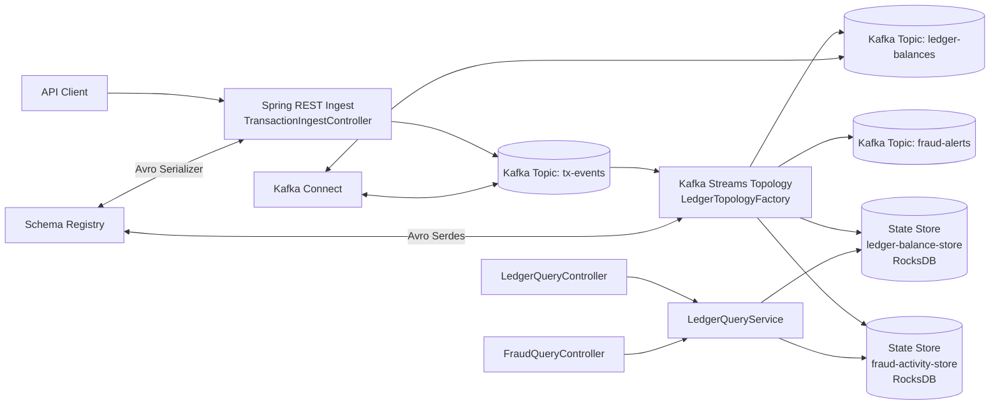
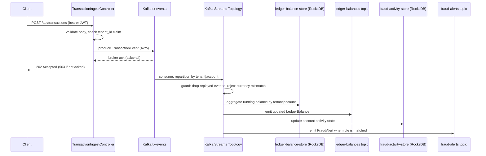
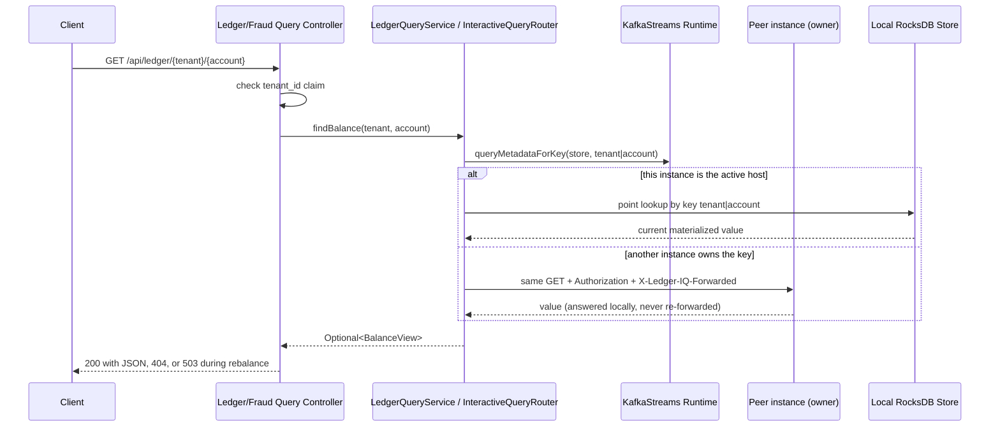
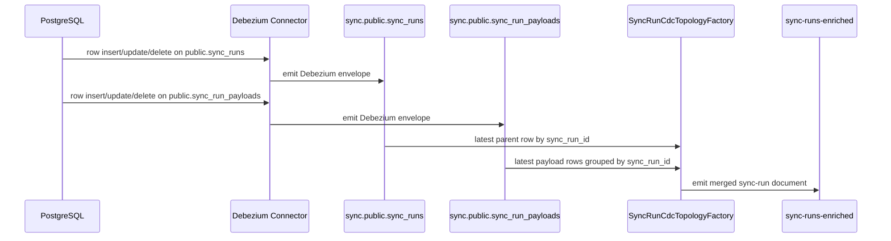

# Application Architecture and Kafka Streams Theory

This document is the deep technical reference for this repository.

It explains:
- every major application module and responsibility
- internal communication paths from API to topics to state stores
- integrations with Kafka, Schema Registry, Kafka Connect, and monitoring
- Kafka and Kafka Streams theory tied directly to this codebase

If you are onboarding for a senior Kafka role, this is the document to read after `README.md` and before running advanced labs from `docs/testing-playbook.md`.

## 1. System Goal and Domain Model

This project implements a small finance-oriented event platform with two core capabilities:

- ledgering: maintain running account balances from transaction events
- fraud signal generation: detect suspicious events based on amount and burst activity

It is intentionally designed around stateful stream processing so you can practice:

- source-of-truth streaming models
- interactive queries on local state stores
- exactly-once stream processing mode
- schema-governed event contracts
- multi-tenant key modeling

## 2. High-Level Architecture



## 3. Runtime Components and Responsibilities

### 3.1 Spring Boot application

- Entry point: `src/main/java/com/example/ledger/LedgerLearningApplication.java`
- Hosts REST APIs and Kafka Streams runtime in one process.

### 3.2 API layer (`src/main/java/com/example/ledger/api`)

- `TransactionIngestController`
  - accepts `POST /api/transactions`
  - maps HTTP payload to Avro `TransactionEvent`
  - publishes to `tx-events`
- `LedgerQueryController`
  - serves `GET /api/ledger/{tenantId}/{accountId}`
  - returns current materialized balance from state store
- `FraudQueryController`
  - serves `GET /api/fraud/{tenantId}/{accountId}`
  - returns current fraud activity state snapshot

### 3.3 Stream processing layer (`src/main/java/com/example/ledger/streams`)

- `LedgerTopologyFactory`
  - builds the topology (DSL + Processor API)
  - repartitions by `tenantId|accountId` and runs the ingress guard
  - performs balance aggregation into a KTable-backed state store
  - invokes the fraud processor and emits alerts
- `TransactionGuardProcessor`
  - drops replayed `eventId`s (window store, per-account scope)
  - pins each account's currency; mismatches go to `ledger-dlq`
- `SyncRunCdcTopologyFactory`
  - consumes Debezium CDC topics for `public.sync_runs` and `public.sync_run_payloads`
  - re-keys child payload events by `sync_run_id`
  - materializes latest parent row and current payload collection
  - emits merged JSON documents to `sync-runs-enriched`
- `FraudDetectionProcessor`
  - stateful `FixedKeyProcessor` (modern Processor API)
  - tracks per-account event burst window
  - emits `FraudAlert` when threshold rules are met
  - evicts idle accounts on stream time via an expiry-index store
- `LedgerQueryService` + `InteractiveQueryRouter`
  - accesses `KafkaStreams` interactive query API
  - answers from the local store or forwards to the instance that owns the key
- `Topics`
  - central names for topics and stores

### 3.4 Configuration layer (`src/main/java/com/example/ledger/config`)

- `KafkaStreamsConfig`
  - enables Kafka Streams with `@EnableKafkaStreams`
  - configures Avro serdes for all five Avro contracts
  - wires the ledger/fraud, payment, windowed-join, revenue and CDC topologies
  - sets the uncaught-exception policy (`SHUTDOWN_CLIENT`)
- `TopicConfig`
  - creates topics at startup via Spring Kafka Admin
  - marks `ledger-balances` and `sync-runs-enriched` as compacted
- `LedgerStreamProperties`
  - binds fraud thresholds and the dedup window from `application.yml`
- `LedgerMetrics`, `KafkaStreamsHealthIndicator`
  - business counters for Prometheus; Streams client state in liveness/readiness
- `StreamsDeserializationErrorHandler`, `StreamsProductionExceptionHandler`
  - dead-letter poison pills; fail (never skip) on production errors

### 3.4b Security layer (`src/main/java/com/example/ledger/security`)

- `SecurityConfig` — stateless OAuth2 resource server (JWT); disabled only when
  `app.security.enabled=false` (local docker-compose)
- `TenantAccess` — the token's `tenant_id` claim must match the tenant in every request

### 3.5 Infrastructure integrations

- Kafka broker and ZooKeeper: `docker-compose.yml`
- Schema Registry: `docker-compose.yml`
- Kafka Connect: `docker-compose.yml` and `connect/*.json`
- Kafka UI: `docker-compose.yml`

## 4. Internal Communication Paths

### 4.1 Write path: HTTP -> Kafka -> Streams -> state/topics



### 4.2 Read path: HTTP -> Interactive Query -> owning instance's state store



### 4.3 Key model and tenant isolation

This system uses a canonical composite key format:

- key: `tenantId|accountId`

Why it matters:

- ensures tenant scoping in all state stores
- all events for one account land on one partition (required by the dedup guard and the aggregate)
- keeps query contract deterministic between topology and API
- IDs are validated (`[A-Za-z0-9._-]{1,64}`), so no ID can contain `|` and forge another tenant's key
- partitioning hashes the full key, not `tenantId` alone, to avoid hot partitions for large tenants
- at the API, the JWT `tenant_id` claim must match the tenant being read or written

### 4.4 CDC merge path: Postgres -> Debezium -> Kafka Streams -> merged topic



This path demonstrates a common financial-integration pattern:

- CDC captures operational database changes without polling.
- Kafka Streams turns table-shaped change events into a consumer-friendly domain view.
- downstream services read one merged topic instead of implementing their own joins.

## 5. Data Contracts and Topic Catalog

### 5.1 Avro contracts

Source of contracts (selection; also `PaymentEvent.avsc`, `TenantRevenue.avsc`):
- `src/main/avro/TransactionEvent.avsc`
- `src/main/avro/LedgerBalance.avsc`
- `src/main/avro/FraudAlert.avsc`

All money fields are Avro `decimal(19,4)` (`BigDecimal` in Java), never floating point.

#### TransactionEvent

| Field | Type | Description |
|---|---|---|
| eventId | string | Event identity from producer/API |
| tenantId | string | Tenant scope |
| accountId | string | Account scope within tenant |
| amount | decimal(19,4) | Positive amount from request |
| direction | enum(DEBIT,CREDIT) | Sign behavior in aggregation |
| currency | string | ISO-4217 code, validated; defaults to USD |
| eventTime | long | Epoch millis event timestamp |

#### LedgerBalance

| Field | Type | Description |
|---|---|---|
| tenantId | string | Tenant of the account |
| accountId | string | Account identifier |
| balance | decimal(19,4) | Running signed balance |
| currency | string | The account's currency (fixed by its first event) |
| lastEventTime | long | Last processed event timestamp |

#### FraudAlert

| Field | Type | Description |
|---|---|---|
| tenantId | string | Tenant scope |
| accountId | string | Account scope |
| eventId | string | Triggering event id |
| reason | string | Rule reason code |
| amount | decimal(19,4) | Triggering event amount |
| eventTime | long | Triggering event timestamp |

### 5.2 Topics and stores

| Name | Kind | Partitions | Compacted | Produced by | Consumed by |
|---|---|---:|---|---|---|
| `tx-events` | Topic | 6 | No | `TransactionIngestController` | Streams topology |
| `ledger-balances` | Topic | 6 | Yes | Streams aggregation | Downstream consumers / Connect |
| `fraud-alerts` | Topic | 6 | No | Fraud processor path | Downstream consumers |
| `ledger-dlq` | Topic | 3 | No | Ingress guard (currency mismatch) | Operations / triage |
| `ledger-balance-store` | State store | N/A | N/A | Streams aggregation | Interactive query API |
| `tx-dedup-store` | State store (window) | N/A | N/A | Ingress guard | — |
| `account-currency-store` | State store | N/A | N/A | Ingress guard | — |
| `fraud-activity-store` | State store | N/A | N/A | Fraud processor | Interactive query API |
| `fraud-expiry-index-store` | State store | N/A | N/A | Fraud processor | — |

Note: changelog topics for state stores are created automatically by Kafka Streams.

## 6. Topology Walkthrough (Code-Level)

Reference file: `src/main/java/com/example/ledger/streams/LedgerTopologyFactory.java`

### Step A: consume input stream

- Reads `tx-events` as `KStream<String, TransactionEvent>`.
- Uses `Consumed.with(StringSerde, TransactionEventSerde)`.

### Step B: re-key and repartition for tenant/account partitioning

- `selectKey((k, v) -> v.getTenantId() + "|" + v.getAccountId())`
- `repartition(... withName("tx-by-account"))` — explicit, so the guard in step B2 sees every
  event for an account on the same task regardless of how producers keyed `tx-events`.
- This key is reused everywhere else.

### Step B2: ingress guard

- `processValues(() -> new TransactionGuardProcessor(dedupWindow, metrics), ...)`
- Replayed `eventId`s are dropped; currency mismatches are split off to `ledger-dlq`.
- Only accepted events reach the aggregate and the fraud processor.

### Step C: aggregate balances into KTable

- Groups by key and aggregates into `LedgerBalance`.
- Signed amount logic:
  - `DEBIT` -> subtract absolute amount
  - `CREDIT` -> add absolute amount
- Materializes to store name `ledger-balance-store`.

Formula used (exact `BigDecimal` arithmetic at scale 4):

```text
newBalance = oldBalance + signedAmount
signedAmount = +abs(amount) for CREDIT
signedAmount = -abs(amount) for DEBIT
```

### Step D: publish materialized updates

- `balances.toStream().to("ledger-balances")`
- This emits a new balance record for each aggregate update.

### Step E: execute fraud processor

- Invokes `processValues(() -> new FraudDetectionProcessor(properties), ..., "fraud-activity-store", "fraud-expiry-index-store")`
- Updates activity store and emits alert only when a rule matches.
- Null results are filtered out before writing to `fraud-alerts`.

## 7. Fraud Logic Internals

Reference file: `src/main/java/com/example/ledger/streams/FraudDetectionProcessor.java`

Rules currently implemented:

1. single transaction threshold:
   - alert when `abs(amount) >= singleTransactionAlertThreshold`
2. burst activity threshold:
   - track event count in window per account
   - reset window when `eventTime - windowStartMs > burstWindowMs`
   - alert when `eventsInWindow >= burstCountThreshold`

Alert reason mapping:

- `SINGLE_TX_THRESHOLD_EXCEEDED`
- `BURST_ACTIVITY_DETECTED`

State object used:

- `AccountActivity` with fields `eventsInWindow`, `windowStartMs`, `lastEventTime`

State cleanup:

- a `STREAM_TIME` punctuator (every 30 s of event time) evicts accounts idle for more than
  `2 × burstWindowMs`
- stream time, because `lastEventTime` is event time — a wall-clock comparison would evict
  everything when replaying history and nothing while catching up on a backlog
- `fraud-expiry-index-store` (key `zeroPaddedLastEventTime|accountKey`) lets each punctuation
  range-scan only expired entries instead of the whole activity store

## 8. Query Model and Interactive Queries

Reference files: `src/main/java/com/example/ledger/streams/LedgerQueryService.java`,
`src/main/java/com/example/ledger/streams/InteractiveQueryRouter.java`

Query steps:

1. Build key as `tenantId|accountId`
2. Ask Kafka Streams which instance is the active host for the key (`queryMetadataForKey`)
3. If it is another instance, forward the HTTP call to it (with the caller's token)
4. Otherwise retrieve the named local store via `StoreQueryParameters` and `store.get(key)`
5. Map Avro/internal model into API view object

Important behavior:

- queries read RocksDB state, not the broker directly
- each instance advertises `application.server`; in k8s that is the pod's stable StatefulSet DNS name
- a forwarded request is always answered locally (no forwarding loops during rebalances)
- if the runtime is not running or a store is restoring, the API returns `503` with `Retry-After`
- if key is absent, controllers return HTTP 404

## 9. Kafka Theory (Mapped to This Project)

### 9.1 Topics, partitions, and ordering

Kafka topics are append-only logs split into partitions.

In this project:
- all main topics use 6 partitions
- ordering is guaranteed per partition, not globally
- by keying with `tenantId|accountId`, account-level order is preserved

### 9.2 Consumer groups and parallelism

A consumer group distributes partitions across active members.

In this project:
- Kafka Streams app is a consumer group identified by `application-id`
- partitions are split across stream threads/instances
- state stores are sharded by partition ownership

### 9.3 Offsets and replay

Consumers track offsets; replay is possible by resetting offsets.

In this project:
- topology can rebuild state stores by replaying changelog/input topics
- this is central to recoverability and deterministic materialization

### 9.4 Log compaction

Compaction keeps latest value per key.

In this project:
- `ledger-balances` is compacted to represent latest account balance snapshot per key
- this supports downstream systems that need current state, not full event history

### 9.5 Schema governance with Avro + Schema Registry

Schema Registry stores schema versions and compatibility rules.

In this project:
- producer and streams use Avro serdes
- schema IDs are embedded in records
- compatibility can be validated through Registry APIs

### 9.6 Delivery semantics and EOS

Kafka supports at-most-once, at-least-once, and exactly-once modes.

In this project:
- `processing.guarantee: exactly_once_v2` is configured
- stream processing and output writes are transactional
- this improves consistency for financial data flows

EOS does not stop the *same business event* from arriving twice (e.g. a retried POST produces a
new record). Business-level idempotency is handled separately by the ledger's `eventId`
de-duplication store.

## 10. Kafka Streams Theory (Mapped to This Project)

### 10.1 KStream vs KTable

- `KStream`: immutable event stream (every event matters)
- `KTable`: latest value per key (materialized view)

In this project:
- input is a `KStream<TransactionEvent>`
- balances are represented as a `KTable<key, LedgerBalance>`

### 10.2 Stateful operations

Stateful operations (aggregate, join, window) require local state stores.

In this project:
- balance aggregate is stateful and materialized
- fraud transformer uses explicit state store for per-account window activity

### 10.3 Repartitioning and key discipline

When key changes, Kafka Streams may need repartition topics.

In this project:
- `selectKey` changes key to `tenant|account`
- group-by-key aligns aggregation and fraud logic on the same key contract

### 10.4 State stores and RocksDB

Kafka Streams default persistent store engine is RocksDB.

In this project:
- store files live under `state.dir` from `application.yml`
- each store has a changelog topic for recovery
- interactive queries read from this local state

### 10.5 Processor API vs DSL

- DSL is concise for common stream operations
- Processor API offers full control over state and custom flow

In this project:
- DSL handles ingest, keying, grouping, aggregation, and output
- Processor API handles fraud detection logic with custom state transitions

### 10.6 Testing topology deterministically

`TopologyTestDriver` allows deterministic unit-level testing without a Kafka cluster.

In this project:
- `src/test/java/com/example/ledger/streams/LedgerTopologyTest.java`
- validates balance math and fraud threshold behavior

## 11. Configuration Deep Dive

Primary config file: `src/main/resources/application.yml`

Notable settings:

- `spring.kafka.bootstrap-servers`: cluster endpoint
- `schema.registry.url`: Avro schema lookup
- `request.timeout.ms` and `default.api.timeout.ms`: admin/client timeout behavior
- `spring.kafka.streams.application-id`: consumer group identity for Streams
- `processing.guarantee: exactly_once_v2`: transactional stream mode
- `state.dir`: local path for RocksDB stores
- `num.stream.threads`: local processing concurrency
- `commit.interval.ms`: processing cadence and durability tradeoff

Operational note:

- ensure `default.api.timeout.ms >= request.timeout.ms` to avoid admin startup failures

## 12. External Integrations

### 12.1 Schema Registry

- Used by Avro serializer and deserializer.
- Required when producing/consuming Avro topics in this app.

Quick checks:

```bash
curl -s http://localhost:8081/subjects
curl -s http://localhost:8081/config
```

### 12.2 Kafka Connect

Connector configs:
- `connect/ledger-source.json`
- `connect/ledger-sink.json`

Current examples use file connectors and String converters to keep local learning simple.

Quick checks:

```bash
curl -s http://localhost:8083/connectors
curl -s http://localhost:8083/connectors/ledger-file-source/status
```

### 12.3 Kafka UI

- URL: `http://localhost:8085`
- Use this to inspect topics, partitions, consumer groups, and messages.

### 12.4 Actuator metrics and health

- health endpoint: `/actuator/health`
- metrics catalog: `/actuator/metrics`

Example:

```bash
curl -s http://localhost:8080/actuator/health
curl -s http://localhost:8080/actuator/metrics
```

## 13. End-to-End Integration Scenarios

### Scenario A: ledger correctness

1. post credit event
2. post debit event
3. query ledger endpoint
4. verify `balance = credit - debit`

### Scenario B: fraud path

1. post event above amount threshold
2. query fraud endpoint
3. verify alert reason and activity state updated

### Scenario C: tenant isolation

1. post same account ID for two tenants
2. query each tenant/account
3. verify independent balances and no cross-tenant leakage

### Scenario D: recovery behavior

1. process sample traffic
2. restart application
3. verify queries recover from restored state/changelogs

## 14. Testing Strategy and Quality Layers

### Unit and topology tests

- topology tests (`LedgerTopologyTest`, `PaymentTopologyTest`, `RevenueAggregationTopologyTest`, …)
  use a mock schema registry, `TopologyTestDriver` and the production event-time extractor; they
  cover duplicate event IDs, mixed-currency rejection, exact decimal arithmetic, stream-time
  eviction and business metrics
- `ApiSecurityAndValidationTest` covers auth (`401`/`403`), validation (`400`) and ack semantics
  (`202`/`503`); `StreamsDeserializationErrorHandlerTest` covers dead-lettering

### Integration and manual labs

- `docs/testing-playbook.md` provides 14 structured labs from smoke test to resilience and performance

### Recommended additions for senior-level coverage

- out-of-order event policy tests
- Testcontainers integration test against a real broker (incl. multi-instance IQ routing)
- recovery time and lag SLO checks

## 15. Known Boundaries and Upgrade Path

Current boundaries in this repository:

- payment commands are not idempotent (a retried command is rejected to `payment-dlq`)
- fraud thresholds are a single number across all currencies
- simple fraud logic and no risk scoring pipeline
- no CI pipeline or broker-backed integration tests

Suggested upgrade path:

1. add idempotency for payment commands (e.g. by `correlationId`)
2. per-currency fraud thresholds
3. add richer fraud models (rolling sums, velocity, anomaly)
4. introduce CI with schema compatibility and contract gates
5. Testcontainers integration tests, including cross-instance query routing

## 16. Practical Navigation

Use this order for deep study:

1. `README.md`
2. `docs/application-architecture-and-kafka-theory.md` (this document)
3. `docs/testing-playbook.md`
4. `docs/advanced-guide.md`
5. source code under `src/main/java/com/example/ledger`

For interview preparation, focus on being able to explain:

- why the key model is `tenantId|accountId`
- why balance is modeled as KTable + compacted topic
- how state stores and changelog recovery work
- what EOS does and does not guarantee in this implementation
- when to use DSL vs Processor API

